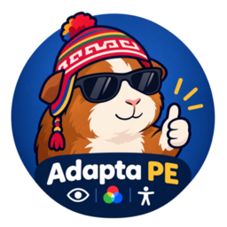

<p align="center"></p>

# Adapta PE Base para Windows

Aplicación nativa de accesibilidad en **C# y WPF** para usar el escritorio con voz, mover el cursor con una cámara, leer controles accesibles y aplicar siete filtros de color. Incluye mascotas, bandeja, panel flotante e IA externa opcional. Funciona de forma independiente: no necesita una extensión, Python ni un servidor local.

Esta edición está pensada para quien necesita combinar voz y control corporal en aplicaciones de Windows. Si buscas voz, lectura manual, filtros y mascotas sin cámara ni IA, consulta [Windows Lite](https://github.com/TheAlejo160/Adapta-PE-Lite-Win).

La versión pública es **1.0** y la revisión técnica del ejecutable es **1.0.3.0**. Hay implementación y paquetes locales de prueba; eso no acredita una release pública validada. El autor confirmó instalación y uso de la antigua 0.2.1. Los cambios actuales necesitan pruebas de WPF, micrófono, cámara, UI Automation e instalación en Windows real. [Plan de validación](docs/VALIDACION-WINDOWS.md).

- [Instalar y actualizar](#instalar-y-actualizar)
- [Compilar desde el repositorio](#compilar-desde-el-repositorio)
- [Primera orden y reconocimiento de voz](#primera-orden-y-reconocimiento-de-voz)
- [Aplicaciones, sitios y teclado](#aplicaciones-sitios-y-teclado)
- [Dictado, controles y elecciones](#dictado-controles-y-elecciones)
- [Lectura y filtros](#lectura-y-filtros)
- [Cursor con cámara y clic por permanencia](#cursor-con-cámara-y-clic-por-permanencia)
- [Mascota, panel y bandeja](#mascota-panel-y-bandeja)
- [IA opcional y privacidad](#ia-opcional-y-privacidad)
- [Cómo funciona y cómo comprobarlo](#cómo-funciona-y-cómo-comprobarlo)
- [Solución de problemas](#solución-de-problemas)

## Windows, runtimes y arquitectura

| Compilación | Destino previsto | Requisitos y límites |
| --- | --- | --- |
| `net10.0-windows` | Principal, Windows 11 y pruebas prioritarias en Windows 10 | .NET Desktop Runtime 10 si el paquete no es autocontenido. El instalador actual sólo admite Windows 10/11 x64. |
| `net48` | Legacy: Windows 7 SP1, 8.1 y vía alternativa para Windows 10 | .NET Framework 4.8 instalado. Ejecución, sensores y dependencias nativas pendientes de validar en cada sistema. |
| `net461` | Histórica: Windows 8.0 | .NET Framework 4.6.1; compilación distinta y experimental. El importador ONNX antiguo puede rechazar modelos actuales: no se acredita paridad de cámara. |

El destino inicial es **x64**. `build.ps1 -Runtime win-x86` permite generar x86 para Windows x86, pero no incluye el runtime Vosk x64. Magnification API requiere arquitectura nativa: un proceso x86 bajo Windows x64 no sirve para estos filtros. No hay distribución ARM64 validada ni instalador Legacy acreditado.

La compatibilidad prevista por este proyecto y el soporte oficial del runtime son distintos. Windows 10 Home/Pro 22H2 no se declara plataforma oficialmente soportada por .NET 10; consulta las ediciones y builds de la [matriz Microsoft de .NET en Windows](https://learn.microsoft.com/en-us/dotnet/core/install/windows). Windows 7/8/8.1 y Framework 4.6.1 son vías históricas sin soporte vigente. [Requisitos de .NET Framework](https://learn.microsoft.com/en-us/dotnet/framework/get-started/system-requirements).

## Instalar y actualizar

### Si recibiste un instalador del autor

El paquete moderno se llama `AdaptaPE-1.0-Setup-x64.exe`. `artifacts/` contiene salidas locales y está excluido de Git: **clonar este repositorio no descarga ese EXE**. No se presupone una release descargable; puedes construirlo con los pasos siguientes.

1. Cierra la versión anterior desde la bandeja junto al reloj. Cerrar Ajustes mantiene la asistencia activa.
2. Ejecuta el instalador. Si SmartScreen muestra que Windows protegió tu PC, y has comprobado la procedencia del archivo, usa **Más información → Ejecutar de todas formas**, si Windows ofrece esa opción. El paquete local documentado no tiene firma Authenticode. Una detección de malware o una restricción administrada requiere revisar ese aviso concreto; no desactives SmartScreen, antivirus ni UAC.
3. El asistente instala por usuario en `%LOCALAPPDATA%\Programs\AdaptaPE` y permite elegir accesos en escritorio e Inicio. No activa el inicio con Windows.
4. Incluye .NET y modelos. Si falta Visual C++ x64 compatible, inicia el redistribuible oficial incluido, que puede pedir autorización de administrador. Adapta PE se utiliza como usuario normal.
5. Abre Adapta PE desde el acceso directo. En el primer inicio, la asistencia está apagada.

Las actualizaciones son manuales. El instalador distingue **Actualizar** y **Reparar**, conserva preferencias y accesos elegidos, y bloquea sustituir una revisión técnica superior. Registra por separado la versión pública `1.0` y la revisión `1.0.3.0`. No busca instalaciones portables por todo el disco ni consulta actualizaciones en red al iniciar.

Para desinstalar, cierra la app desde la bandeja y usa **Configuración → Aplicaciones**, o `Uninstall.exe` en su carpeta. El desinstalador retira archivos conocidos y accesos propios; conserva preferencias, clave cifrada, archivos ajenos y runtimes Microsoft compartidos. Elimina antes la clave desde **IA opcional → Eliminar clave** si quieres retirarla también.

### Si recibiste una carpeta portable

Conserva toda la carpeta, incluidos DLL, `models/`, `mascotas/` y licencias, y ejecuta `AdaptaPE.exe`. Un EXE aislado no basta. Sólo las publicaciones modernas no autocontenidas requieren [.NET Desktop Runtime 10 x64](https://dotnet.microsoft.com/download/dotnet/10.0); el SDK es para desarrollar. OpenCV necesita Visual C++ compatible y componentes multimedia; Windows N/KN puede requerir Media Feature Pack.

## Compilar desde el repositorio

Haz estos pasos en **Windows**, desde PowerShell. Necesitas Git, **SDK .NET 10** y acceso a NuGet para restaurar paquetes. El repositorio no fija un parche con `global.json`; la compilación cruzada registrada del 17 de octubre usó **SDK 10.0.402**, según [VALIDACION-WINDOWS.md](docs/VALIDACION-WINDOWS.md). Los targets reales son `net10.0-windows;net48;net461`.

Instala el SDK desde la [descarga oficial de .NET 10](https://dotnet.microsoft.com/download/dotnet/10.0). Para usar IDE, Microsoft indica **Visual Studio 2026 18.0 o posterior** para .NET 10; instala la carga de desarrollo de escritorio .NET y abre `src/AdaptaPE/AdaptaPE.csproj`. [SDK y Visual Studio](https://learn.microsoft.com/en-us/dotnet/core/install/windows#install-with-visual-studio).

```powershell
git clone https://github.com/TheAlejo160/Adapta-PE-Win.git
Set-Location Adapta-PE-Win
dotnet --info
dotnet restore src/AdaptaPE/AdaptaPE.csproj
dotnet build src/AdaptaPE/AdaptaPE.csproj -f net10.0-windows -c Release
dotnet run --project src/AdaptaPE/AdaptaPE.csproj -f net10.0-windows -c Release
```

`dotnet run` abre la app y permite activar sensores; no es una prueba automática. Cierra desde la bandeja antes de empaquetar o comprobar otro ejecutable.

### Publicar una carpeta o construir Legacy

```powershell
# Principal x64 dependiente del Desktop Runtime 10.
./scripts/build.ps1

# Principal x64 con .NET incluido.
./scripts/build.ps1 -Framework net10.0-windows -Runtime win-x64 -SelfContained

# Legacy: cada una requiere su .NET Framework instalado en el equipo de destino.
./scripts/build.ps1 -Framework net48
./scripts/build.ps1 -Framework net461
```

`build.ps1` escribe en `artifacts/<framework>-<runtime>/`. Sus publicaciones modernas con y sin `-SelfContained` usan la misma carpeta: genera cada variante por separado. Para ejecutar la publicación principal en Windows:

```powershell
& ./artifacts/net10.0-windows-win-x64/AdaptaPE.exe
```

.NET Framework no admite `-SelfContained`. Los paquetes de ensamblados de referencia permiten compilar Legacy, pero no instalan el runtime en el equipo destinatario. El instalador moderno no permite elegir Windows 7/8 para convertirlo en Legacy.

### Generar el instalador x64

Necesitas **NSIS 3.13**, con `makensis` en PATH o su ruta explícita. Usa la [descarga de NSIS](https://nsis.sourceforge.io/Download). El redistribuible Microsoft se excluye de Git; descarga el fijado en [assets/prerequisites/manifest.json](assets/prerequisites/manifest.json) y comprueba su hash:

```powershell
$adaptaPrerequisite = Get-Content ./assets/prerequisites/manifest.json -Raw | ConvertFrom-Json
$adaptaVcPath = Join-Path (Get-Location) 'assets/prerequisites/VC_redist.x64.exe'
Invoke-WebRequest -Uri $adaptaPrerequisite.url -OutFile $adaptaVcPath
if ((Get-FileHash $adaptaVcPath -Algorithm SHA256).Hash.ToLowerInvariant() -ne $adaptaPrerequisite.sha256) {
    throw 'La descarga no coincide. Revisa su procedencia y el manifiesto antes de empaquetar.'
}
./scripts/installer.ps1 -MakeNsis 'C:/Program Files (x86)/NSIS/makensis.exe'
```

La URL de Microsoft puede cambiar de contenido. No omitas la comprobación ni sustituyas el hash sin revisar el archivo. `installer.ps1` también valida el hash, publica en `artifacts/net10.0-windows-win-x64-contained/`, incorpora licencias y genera la lista específica de desinstalación. El resultado es `artifacts/AdaptaPE-1.0-Setup-x64.exe`.

Si PowerShell bloquea un script descargado, revisa el archivo y desbloquea sólo ese script con `Unblock-File ./scripts/build.ps1`, o usa los comandos `dotnet` directamente. No hace falta cambiar la política global.

Para actualizar las fuentes, conserva tus cambios locales, ejecuta `git pull --ff-only` y vuelve a compilar. Publicar fuentes o generar un EXE no acredita haber probado ese paquete en Windows.

## Primera orden y reconocimiento de voz

1. Abre **Control → Dispositivos y reconocimiento**. Elige **Micrófono** y **Reconocimiento de voz**.
2. Activa **Activar voz** y comprueba **Señal del micrófono**. Espera a que el estado indique escucha disponible.
3. Di **«Computadora, abre Bloc de notas»**. También puedes decir sólo «Computadora», esperar la señal y dar la orden dentro de **ocho segundos**.
4. Revisa el texto escuchado y la respuesta. **Orden detectada** indica que se entendió una intención; sólo la respuesta posterior informa si Windows permitió la acción.
5. Para detener la asistencia, pulsa **Detener todo**. **Ctrl+Shift+S** ofrece la misma parada si Windows permite registrar el atajo; si está ocupado, usa la ventana, bandeja o panel.

También se aceptan «Computadoras» y «Computador» con la palabra predeterminada. En **Nombre para llamar al asistente** puedes elegir de 1 a 40 caracteres; una palabra personalizada no hereda esos alias. Cambiar motor, micrófono o palabra conserva la intención de escucha y espera la liberación del motor anterior. Detener todo cancela los arranques pendientes.

Para probar una orden sin micrófono, enfoca primero la aplicación externa y luego usa **Control → Escribir una orden → Ejecutar orden**. En ese cuadro escribe la orden sin palabra de activación.

### SAPI, Vosk y voces de lectura

| Opción de la interfaz | Comportamiento |
| --- | --- |
| Automático · SAPI o local incluido | Prefiere un reconocedor SAPI español instalado. Si no está disponible o la escucha termina inesperadamente, permite pasar una vez al local. |
| Local incluido · español | Vosk 0.3.45 win64 con `vosk-model-small-es-0.42`, sin enviar audio a internet. Carga bajo demanda y libera el modelo al apagar Voz. |
| SAPI instalado en Windows | Usa un reconocedor español realmente enumerado en Windows; informa el error si no puede reconocer. |

Los recursos de Vosk están en `assets/models/speech/es/` y `assets/speech-runtime/win-x64/`, con procedencia y hashes en [el manifiesto de voz](assets/models/speech/manifest.json). Se copian al compilar; no se descargan durante el uso. Vosk produce texto normalmente sin puntuación ni mayúsculas automáticas: conservar el texto reconocido no equivale a generarlas.

SAPI necesita reconocimiento y dictado español disponibles, no sólo una voz de lectura. Revisa las opciones de español y voz en **Configuración → Hora e idioma**; instalar un paquete de idioma no garantiza un reconocedor compatible. La app prefiere la cultura del usuario y variantes españolas instaladas, sin asumir que existe `es-PE`. La lectura TTS depende de las voces instaladas; no uses la presencia de TTS como prueba de reconocimiento. Durante la lectura sólo se aceptan interrupciones explícitas para evitar órdenes derivadas de la síntesis propia. «Apaga la voz» detiene la escucha; para reactivarla usa Ajustes o PiP.

### Permitir micrófono y cámara

En Windows 11, revisa **Configuración → Privacidad y seguridad → Micrófono / Cámara**; en Windows 10, **Configuración → Privacidad → Micrófono / Cámara**. Habilita el acceso al dispositivo y el acceso para **aplicaciones de escritorio**, cuando esas opciones estén disponibles. [Permisos de micrófono de Microsoft](https://support.microsoft.com/en-us/windows/privacy/turn-on-app-permissions-for-your-microphone-in-windows).

La app abre esas páginas desde **Permiso del micrófono** y **Permiso de cámara**. **Dispositivos de sonido** ayuda a revisar la entrada elegida. Las rutas modernas pueden no existir en Legacy; consulta los controles del sistema correspondiente. Una política administrada, dispositivo desconectado o micrófono ocupado necesita resolver su causa concreta.

## Aplicaciones, sitios y teclado

Los ejemplos siguientes se dicen después de «Computadora»:

| Quiero… | Orden de ejemplo |
| --- | --- |
| Abrir o enfocar una app | «abre Bloc de notas», «cambia a Discord», «trae Chrome al frente» |
| Ver ventanas | «muestra apps abiertas» |
| Cerrar normalmente | «cierra Chrome», «cerrar la aplicación Word», «ciérrame la app Bloc de notas» |
| Abrir un sitio | «abre You Tube en nueva ventana», «abre la página de Google» |
| Buscar | «busca movilidad en Wikipedia» |
| Abrir en otra pantalla | «abre Visual Studio Code en el monitor dos» |
| Usar atajos | «nueva pestaña», «atrás», «recarga», «guardar», «guardar como», «imprimir», «mostrar escritorio» |
| Combinar teclas | «presiona control shift N» |
| Usar el ratón | «clic», «clic derecho», «doble clic», «abre el menú contextual» |

Las apps deben existir en el equipo. El catálogo combina accesos de Inicio, App Paths del registro y ventanas abiertas; abrir una app ya abierta puede enfocar su ventana. Google/Chrome/crom identifican Chrome cuando corresponde; «abre la página de Google» pide explícitamente el sitio. El catálogo web conserva 28 sitios y sus alias en [Core/Commands.cs](src/AdaptaPE/Core/Commands.cs).

Los cierres revalidan ventana y proceso y solicitan `WM_CLOSE`; no fuerzan terminación ni evitan el diálogo de guardar. Varias ventanas o nombres aproximados requieren elegir. Un título de Chrome que mencione Word no lo convierte en Word. Las órdenes no se convierten en scripts, PowerShell ni argumentos shell arbitrarios.

El navegador enfocado se utiliza cuando se reconoce compatible. La búsqueda contextual intenta identificar el sitio mediante UI Automation y puede volver a Google. No hay acceso al DOM ni equivalencia garantizada con `chrome.tabs`. Reproducir/pausar depende de controles accesibles; no se envía espacio ciegamente a formularios. Los atajos se traducen a Windows: guardar usa Ctrl+S, nueva pestaña Ctrl+T y escritorio Win+D.

Puedes decir «por favor abre Bloc de notas», «quiero que abras Bloc de notas» o «ábrame Bloc de notas». El parser normaliza cortesía y conjugaciones sin alterar el texto de dictado, selección literal o consulta API. Las partículas finales «pe», «pues», «ya pe» y «ya pues» sólo se retiran si llevan coma: «busca Adapta PE» conserva el nombre. Estas reglas de texto españolas no añaden reconocimiento acústico en seis idiomas.

## Dictado, controles y elecciones

1. Enfoca la ventana externa sobre la que quieres trabajar.
2. Di «Computadora, muestra campos» para localizar controles accesibles, o «enfoca Nombre» si conoces su etiqueta.
3. Di «escribe Hola, José en el campo Nombre», o «escribe Hola, José» en el campo enfocado. El dictado conserva el texto recibido, Unicode y signos; después de «escribe», «por favor» puede formar parte del contenido.
4. Para un control, prueba «selecciona Contacto» y «pulsa lo seleccionado». Para texto literal, «selecciona el texto Buenos días»; para un campo, «borra el campo».
5. Si hay varias coincidencias, responde «elige dos», «la segunda», un número o un nombre único. Hay hasta seis opciones por página: «siguiente», «anterior» y «cancelar» permiten navegar o abandonar.

Las elecciones caducan a los **45 segundos** y se cancelan si cambia la aplicación de destino. El panel conserva el destino externo al mostrar opciones. La app excluye campos de contraseña de lectura, selección de texto y dictado; no intentes usarlos como destino.

UI Automation necesita controles que publiquen sus patrones y nombres. En juegos, lienzos o interfaces personalizadas puede no haber campos utilizables. Windows también puede impedir actuar sobre apps elevadas por UIPI; UAC y el escritorio seguro quedan fuera del control de Adapta PE.

## Lectura y filtros

Para leer manualmente, enfoca una app y di «Computadora, lee la pantalla», «léeme la pantalla» o «lee el botón Contacto». Lee el contenido accesible de la ventana externa: **no incorpora OCR** ni garantiza leer lo que la app no expone. «Silencio» o «detén la lectura» interrumpen la salida hablada. También existen «muestra comandos» y «ejecuta la acción Exportar PDF» cuando el destino publica ese menú.

En **Lectura y filtros**, activa **TalkBack: leer controles al señalar** para lectura automática local. Espera unos 300 ms sobre un control, resalta el destino y evita leer continuamente durante TTS o una elección. Es una ayuda complementaria, no un reemplazo completo de Narrador o NVDA.

En **Filtro de pantalla** elige Protanomalía, Protanopía, Deuteranomalía, Deuteranopía, Tritanomalía, Tritanopía o Acromatopsia. **Sin filtro** o **Quitar filtro** retiran el efecto propio. Por voz: «filtro deuteranopía» y «quitar filtro».

Son simulaciones visuales, no una corrección médica. Windows 8+ usa Magnification API para todo el escritorio sin captura continua por el código de filtros. Windows 7 tiene una capa local a 10 FPS, pendiente de validar. La app comprueba propiedad/estado al restaurar para no deshacer el efecto de otra ayuda y conserva recuperación para el siguiente inicio tras una terminación abrupta.

## Cursor con cámara y clic por permanencia

En **Control → Cámara y consumo**, elige **Cámara (índice)**. En **Adaptar a mi movimiento → Control con**, elige uno de los tres modos y activa **Activar cursor con cámara**:

| Modo visible | Cómo empezar |
| --- | --- |
| Cabeza | Mantén una postura cómoda hasta calibrar. La referencia necesita al menos cuatro muestras distintas durante 900 ms; **Calibrar** permite repetirla. |
| Manos | Usa la primera posición como reposo de joystick. Desplaza ligeramente la zona visible para moverte y vuelve al inicio para frenar. Conserva centro fijo. |
| Zona libre | Muestra un detalle con contraste y muévelo ligeramente para adquirirlo. Sigue textura, sin exigir anatomía; superficies uniformes, repetidas u oclusiones pueden impedir seguimiento. |

Cabeza permite seguimiento de cabeza/torso; Manos cubre brazos, manos o puños; Zona libre sigue una zona con textura. El motor conserva la fuente mientras sea válida. El modo de manos usa muñeca y orientación estimada, con apoyo corporal de muñecas/codos visibles. Zona libre requiere otra adquisición tras una pérdida prolongada. Los nombres de modos antiguos se migran al equivalente; no necesitas borrar preferencias.

La vista aparece en Control y PiP, también durante calibración o pausa. Verde señala reposo, naranja el anillo de armado y el punto blanco el desplazamiento. **Perfil equilibrado** aplica velocidad 1 y amplitud 0,65; **Perfil ágil**, 1,5 y 0,65. Ajusta **Velocidad**, **Amplitud (menos: movimientos pequeños)** y **Reducir temblores** a tu postura. Cambiar temblor recalibra. **Pausar / reanudar** permite descansar.

### Hacer un clic

Activa **Clic por permanencia · dwell**, sal del anillo naranja y vuelve al verde sobre el mismo objetivo. Mantén la postura hasta completar el progreso junto al cursor. Hace **un clic por entrada**; para otro, repite la salida y el regreso. **Siguiente clic derecho** cambia el próximo clic. Si no hay semántica UIA, el destino usa una región pequeña con ventana verificada.

La espera predeterminada es **1 segundo**, ajustable entre **0,4 y 5 segundos** en **Espera de clic (segundos)**. **200 ms no es el tiempo de permanencia**: es el hueco entre muestras que desarma el clic pendiente (300 ms al elegir 5 detecciones/s). Pérdida, pausa, calibración y cambio de fuente también cancelan el clic. Mover el ratón físico pausa el control durante dos segundos y exige estabilidad al regresar.

Por voz puedes usar «control cabeza», «control manos», «control brazo izquierdo», «control zona libre», «calibrar cursor», «activar temblor», «movimientos pequeños», «cursor más rápido», «cursor más lento», «modo preciso», «modo rápido», «activar clic automático», «desactivar dwell», «pausar cursor», «reanudar cursor» y «siguiente clic derecho». «Cancelar clic» retira sólo el clic pendiente, sin apagar la cámara. Se conservan alias como «postura cómoda», «centrar cursor», «descansar», «continuar cursor», «control rostro», «control muñón» y «movilidad reducida».

### Cámara, consumo y varias pantallas

La captura solicita 640×480; cabeza trabaja a 320×240 y textura a 160×120. Las detecciones se configuran entre 5 y 30 por segundo, con 12 por defecto. Preview visible hasta 24 FPS, inferencia y movimiento son independientes: hay un solo frame pendiente y una inferencia en vuelo. El cursor integra velocidad por tiempo, aproximadamente cada 15 ms; una muestra con más de 350 ms no mantiene movimiento. Volver al reposo frena sin esperar al suavizado visual.

OpenCV ejecuta un hilo de cómputo y carga modelos del modo activo bajo demanda: YuNet para cabeza y modelos MediaPipe de OpenCV Zoo para manos/cuerpo. No se requiere GPU ni se graban frames. Estos son límites del diseño, **no mediciones de CPU, RAM, latencia o precisión**. No se acredita detección universal para cualquier condición motora, iluminación o cámara.

La entrada contempla escritorio virtual, coordenadas negativas y varios monitores; DPI mixto necesita prueba real. En juegos que rechazan capas exclusivas, prueba ventana sin bordes/pantalla completa de escritorio. Entrada propia o antitrampas puede rechazar acciones sintéticas; no se eluden esas restricciones.

## Mascota, panel y bandeja

En **Mascota → Tu mascota**, elige **Tinku** (gallito), **Cuchu** (cuy), **Yati** (llama) o **Sin mascota**, el valor inicial. Sólo carga el atlas seleccionado. El dibujo deja pasar clics; arrastra su nombre o pulsa **Mover con teclas**, usa flechas y vuelve con Escape. **Otro monitor** cambia su pantalla. Guarda monitor y posición relativa.

**Saludar**, **Dormir** y **Despertar** controlan su actividad. Tras 90 segundos sin interacción descansa y detiene la animación; una acción despierta el descanso automático. Dormir manualmente requiere Despertar. Lectura y habla acompañan el TTS real, sin descanso automático durante la salida; teléfono y laptop se animan una vez por llamada/orden. Movimiento reducido y suspensión detienen la animación.

Por voz: «mascota Cuchu», «mascota Cu Chu», «mascota Tinku», «mascota Yaty», «oculta mascota», «saluda mascota», «duerme mascota» y «despierta mascota». Son órdenes completas; una búsqueda o dictado que mencione la mascota conserva su contenido.

Abre **Usar panel · PiP** para mantener los controles a mano. Arrastra su barra de título; en **Opciones del panel** cambia esquina, **Otro monitor**, **Mascota**, **Filtro de pantalla** o **Mostrar cámara**. Ocultar la imagen no apaga el cursor. Los interruptores **Voz** y **Cursor con cámara** controlan los mismos motores de Ajustes; no abren otro sensor.

Activa **Mover mascota y panel juntos** para colocar la mascota encima del panel y arrastrar ambos desde cualquiera de sus títulos. Al separar, la mascota recupera su posición propia. También sirven «une mascota al panel», «separa mascota del panel» y «panel esquina superior izquierda».

El panel mantiene **Ajustes** y **Detener todo** en un pie fijo. Cerrar Ajustes conserva asistencia, bandeja y panel. Para terminar, usa **Ayuda → Salir de Adapta PE** o la bandeja. En Ayuda puedes elegir monitor/esquina y activar voluntariamente **Iniciar Adapta PE al entrar en Windows**.

**Detener todo** cancela acciones, elecciones, escucha, TTS, cámara, cursor, lectura automática e IA, retira el filtro propio y recuerda los módulos apagados. **Salir** libera recursos conservando preferencias. Bloqueo y suspensión detienen entrada y sensores; al volver se revalidan recursos y el cursor se recalibra. Si un dispositivo no vuelve, reactívalo tras corregir el error.

## IA opcional y privacidad

Las funciones de voz, cámara, lectura y filtros se procesan localmente y no requieren cuenta ni clave. Las búsquedas y aperturas web comunican la consulta al sitio como una navegación normal. No hay telemetría remota por defecto ni envío automático de órdenes desconocidas a IA.

### Configurar un proveedor externo

1. En **IA opcional**, marca **Activar integración de IA externa**.
2. Introduce la URL completa en **Endpoint HTTPS compatible con chat/completions** y el **Modelo del proveedor**. El proveedor y su posible coste son responsabilidad de tu cuenta; no se incluyen créditos.
3. Introduce tu API key y pulsa **Guardar clave**. Se guarda en `provider.key`, cifrada con DPAPI para tu usuario de Windows, fuera del JSON. **Eliminar clave** la retira.
4. Solicita una consulta explícita: «Computadora, pregunta a la IA …».
5. Sólo para imágenes, marca **Permitir enviar pantalla al proveedor durante esta sesión** y di «analiza pantalla con IA». El modelo debe admitir imágenes.

El endpoint exige HTTPS; HTTP sólo se acepta en loopback real (`localhost`, `127.x.x.x` o `::1`). No admite credenciales, consulta ni fragmento en la URL y no sigue redirecciones. **Cambiar el endpoint cancela la consulta, borra la clave anterior y revoca el permiso de pantalla**; si no se puede borrar, conserva el endpoint anterior. Guarda una clave nueva y autoriza pantalla otra vez.

La consulta tiene un **plazo total de 30 segundos**, incluida la lectura del cuerpo. Limita respuestas a 1 MiB y muestra errores de HTTP, configuración o plazo. Apagar IA, retirar el permiso de pantalla o Detener todo cancela la operación correspondiente.

El análisis de pantalla captura el monitor donde está el cursor y puede incluir información privada visible. La exclusión de contraseñas de UIA no oculta píxeles de esa captura: revisa lo que aparece antes de autorizarla. La lectura UIA local no envía imágenes al proveedor. Su tratamiento posterior de los datos depende del servicio que configures.

### Datos locales

Preferencias en `%LOCALAPPDATA%\AdaptaPE\settings.json`, con reemplazo seguro y recuperación ante configuración dañada. La clave cifrada está en la misma carpeta y ligada al usuario mediante DPAPI. No se guardan audio, imágenes, postura corporal ni transcripciones; el texto visible de la sesión permanece en memoria. La desinstalación conserva esa carpeta.

## Cómo funciona y cómo comprobarlo

La interfaz WPF se construye directamente en C#, con recursos de marca propios y estilos nativos. El flujo de una orden es captura → reconocimiento → activación → parser → acción sobre el destino externo → respuesta. No ejecuta el backend Flask simulado ni importa motores Swift/DOM para funcionar.

| Fuente | Responsabilidad |
| --- | --- |
| [App.cs](src/AdaptaPE/App.cs) y [MainWindow.cs](src/AdaptaPE/MainWindow.cs) | Entrada, instancia única, composición WPF, bandeja, PiP y ciclo de vida. |
| [Windows/Voice.cs](src/AdaptaPE/Windows/Voice.cs) y [Core/RecognitionSession.cs](src/AdaptaPE/Core/RecognitionSession.cs) | SAPI/Vosk, captura WinMM, activación, TTS y descarte de sesiones antiguas. |
| [Core/Commands.cs](src/AdaptaPE/Core/Commands.cs) | Gramática finita, normalización, dictado literal, sitios y atajos. |
| [Windows/Actions.cs](src/AdaptaPE/Windows/Actions.cs) y [Windows/DesktopAccess.cs](src/AdaptaPE/Windows/DesktopAccess.cs) | Destino externo, elecciones, UI Automation, lectura y entrada Win32 limitada. |
| [Vision/Camera.cs](src/AdaptaPE/Vision/Camera.cs) y [Vision/LocalVision.cs](src/AdaptaPE/Vision/LocalVision.cs) | Captura OpenCV, inferencia local y preview independiente. |
| [Core/KineticState.cs](src/AdaptaPE/Core/KineticState.cs) | Calibración, física temporal, permanencia y matrices de color. |
| [Core/Mascot.cs](src/AdaptaPE/Core/Mascot.cs) y [Windows/Mascot.cs](src/AdaptaPE/Windows/Mascot.cs) | Secuencias, órdenes, atlas elegido, posición y actividad de mascotas. |
| [Windows/OptionalAI.cs](src/AdaptaPE/Windows/OptionalAI.cs) y [Windows/Preferences.cs](src/AdaptaPE/Windows/Preferences.cs) | IA explícita, consentimiento de pantalla, preferencias y DPAPI. |

UI Automation prioriza patrones de controles y revalida el destino antes de actuar; limita recorridos por tiempo y nodos. Un proveedor COM de otra app puede bloquear: cancelar una tarea no demuestra que se haya interrumpido esa llamada. Las alternativas Win32 respetan las restricciones de Windows y no automatizan UAC.

El [proyecto](src/AdaptaPE/AdaptaPE.csproj) fija OpenCvSharp y runtime Windows `4.10.0.20241108` para moderno/net48; `net461` usa `4.5.3.20210817` y `System.Drawing.Common 5.0.3`. Moderno usa `System.Speech 10.0.12` y `System.Security.Cryptography.ProtectedData 10.0.12`; Legacy referencia los ensamblados Framework. Vosk se incluye como DLL nativa, no como paquete NuGet.

### Comprobaciones de lógica

```powershell
dotnet run --project tests/AdaptaPE.Checks/AdaptaPE.Checks.csproj -c Release
# Alternativa: ejecuta el mismo harness.
./scripts/checks.ps1

# Compilar cada target sin iniciar sensores.
dotnet build src/AdaptaPE/AdaptaPE.csproj -f net10.0-windows -c Release
dotnet build src/AdaptaPE/AdaptaPE.csproj -f net48 -c Release
dotnet build src/AdaptaPE/AdaptaPE.csproj -f net461 -c Release
```

El harness `net10.0` enlaza Core, LocalSpeech y Preferences. Comprueba parser, Unicode, activación, sesiones, elecciones, audio continuo, física, pérdidas, dwell a distintos FPS, matrices, mascotas y validación de preferencias. No usa sensores ni proveedores IA reales; no sustituye una prueba de UI Automation, DPAPI o captura real en Windows.

### Comprobaciones que sí abren Windows y dispositivos

```powershell
# Cierra antes cualquier instancia. Deja Ajustes abierto al terminar.
./scripts/check-startup.ps1 -Executable ./artifacts/net10.0-windows-win-x64/AdaptaPE.exe

# Cierra de nuevo antes de esta prueba. Activa micrófono y exige 30 s de escucha;
# apaga Voz al terminar, pero no acredita precisión de una orden hablada.
./scripts/check-voice.ps1 -Executable ./artifacts/net10.0-windows-win-x64/AdaptaPE.exe
```

Estas pruebas requieren Windows y los permisos correspondientes. No se ejecutan en macOS. `EnableWindowsTargeting` permite compilación cruzada, no ejecutar WPF/Win32 allí. Completa además teclado/lector, bandeja, varios monitores/DPI, suspensión, permisos, dispositivos, instalación y desinstalación según [VALIDACION-WINDOWS.md](docs/VALIDACION-WINDOWS.md).

### Evidencia registrada y revisión documental

El documento de validación registra **889 comprobaciones portables** y compilación cruzada de los tres targets con SDK 10.0.402 el 17 de octubre de 2026, sin errores ni advertencias. El README anterior registraba también un instalador local autocontenido generado ese día, sin firma Authenticode; el bloque de comandos no generó un nuevo instalador. Esos resultados históricos no verifican arreglos posteriores ni garantizan que los binarios locales correspondan a las fuentes actuales.

Esta reescritura del 18 de octubre se verificó por lectura de fuentes, proyectos, scripts, recursos y enlaces locales, desde macOS sin ejecutar .NET. No se recompiló, no se corrieron checks ni se ejecutó el instalador. Siguen pendientes hardware real, rendimiento y experiencia con personas usuarias.

Consulta [LEEME.txt](LEEME.txt) para el paquete, [AdaptaPE.md](AdaptaPE.md) para objetivos de paridad y brechas, [AGENTS.md](AGENTS.md) para desarrollo y [MEMORIA-CODIGO.md](docs/MEMORIA-CODIGO.md) para el mapa. El índice local `adapta-pe-win` es regenerable y está excluido de Git; orienta la navegación, no prueba ejecución. Las fuentes actuales tienen prioridad y NSIS se revisa directamente.

## Solución de problemas

| Síntoma | Qué revisar |
| --- | --- |
| Falta `artifacts/` después de clonar | Es una salida local excluida de Git. Compila o genera el instalador; no hay un EXE dentro del clon. |
| SmartScreen muestra editor desconocido | Revisa procedencia y el aviso. Para el bloqueo de reputación, Más información → Ejecutar de todas formas si está disponible. Una detección de malware o política administrada requiere otra revisión. |
| No aparece la ventana | Busca el icono de bandeja: la instancia puede seguir abierta. Si es arranque nuevo, conserva el mensaje de error y prueba `check-startup.ps1` en Windows. |
| No hay señal de micrófono | Revisa dispositivo en Dispositivos y reconocimiento, permisos para escritorio y otras apps que lo ocupen. Usa Dispositivos de sonido. |
| Hay señal, pero SAPI no escucha | Una voz TTS no es reconocedor. Comprueba español y dictado instalados o elige Local incluido · español. SAPI explícito muestra su error real. |
| Vosk no carga | Conserva `models/speech/es` y todas las DLL x64. La publicación x86 no incluye ese runtime. Recompila sin retirar recursos del paquete. |
| Detecta la orden, pero no actúa | Revisa la respuesta, enfoca el destino externo y cancela/repite la selección. El control debe ser accesible; apps elevadas pueden bloquear entrada por UIPI. |
| No lee o no responde por voz | Revisa voz TTS instalada y salida de audio. Una app puede no publicar contenido UIA; no hay OCR automático. La respuesta escrita permanece disponible. |
| Cámara negra o lenta | Revisa permiso, índice, desconexiones y otras apps. Baja Detecciones por segundo para reducir inferencia; la preview es independiente. FPS reales dependen del equipo/controlador. |
| Cursor incómodo o clic que no termina | Aplica Perfil equilibrado, calibra cómodamente y ajusta amplitud/velocidad/temblor. Sal y vuelve al anillo; pérdida de objetivo o muestras tardías cancela la espera. |
| Falta una DLL o componente multimedia | Conserva toda la publicación. Revisa Visual C++ compatible, runtime .NET del paquete y Media Feature Pack en N/KN; no descargues DLL sueltas de terceros. |
| Filtro no disponible o no se retira | Revisa arquitectura nativa y otra ayuda que controle el filtro. Usa Quitar filtro o Detener todo; conserva el error. Windows 7 y juegos exclusivos necesitan validación aparte. |
| Instalador detecta versión más reciente | Conserva la revisión instalada o usa una superior. Reparar admite la misma revisión; no se elimina la protección de downgrade. |
| IA falla o se agota el plazo | Revisa URL completa chat/completions, modelo, clave y cuota. Hay un plazo total de 30 s y límite de 1 MiB. Cambiar endpoint exige guardar clave y consentimiento nuevos. |
| No se detiene con Ctrl+Shift+S | Otra app puede ocupar el atajo. Usa Detener todo en Ajustes, PiP o bandeja. |

Para reportar un fallo, incluye edición/build de Windows, arquitectura, target, revisión del paquete, dispositivo y mensaje visible. Evita adjuntar claves, audio, capturas privadas o transcripciones personales.

## Familia, licencias y autoría

- [Windows Lite](https://github.com/TheAlejo160/Adapta-PE-Lite-Win): voz, lectura manual, filtros, mascotas y panel; sin cámara, cinética, TalkBack automático ni IA.
- [Extensión Base](https://github.com/TheAlejo160/Adapta-PE) y [Extensión Lite](https://github.com/TheAlejo160/Adapta-PE-Lite): se instalan en el navegador, con alcance y permisos propios.
- [macOS Base](https://github.com/TheAlejo160/Adapta-PE-MacOS-Intel-Apple-Silicon-) y [macOS Lite](https://github.com/TheAlejo160/Adapta-PE-Lite-MacOS): apps nativas y repositorios independientes.
- [Sitio oficial de Adapta PE](https://www.adaptape.cc).

Los números de versión y permisos pertenecen a cada plataforma. Un ZIP de extensión no instala esta aplicación de escritorio. Se portan explícitamente comportamientos y datos de las referencias web/macOS a C#, manteniendo límites de plataforma y de edición.

© 2026 Rodrigo Alejandro Apcho Aliaga, TheAlejo160. Consulta [LICENSE](LICENSE), [LICENSE.txt](LICENSE.txt) y [THIRD_PARTY_NOTICES.md](THIRD_PARTY_NOTICES.md). Los modelos OpenCV Zoo conservan revisión, SHA-256 y licencias independientes; Vosk y sus bibliotecas incluyen sus avisos. Marca y sprites locales se conservan en `assets/brand/` y `assets/mascotas/`. Código y documentación preparados con asistencia de IA; integración y validación Windows bajo supervisión del autor.
